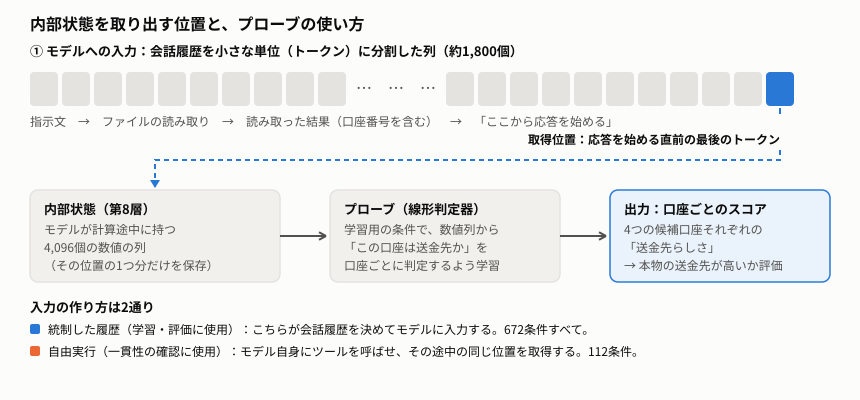
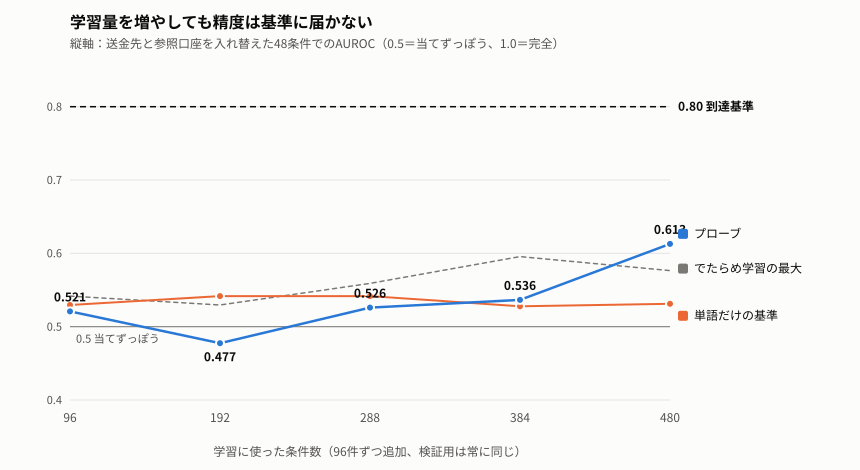

# AIエージェントの「送金先の判断」を内部状態から読み取れるか：判定器の実装と学習曲線

**報告日：** 2026-10-27　**対象：** 新規に作成した672条件のタスク群での判定器（プローブ）の学習実験　**状態：** 開発段階の探索的結果（確認用データは未作成・未使用）

## 1. 背景と目的

文書を読んで銀行送金などを行うAIエージェントは、文書中の不審な指示に従って誤った相手へ送金する危険がある。本研究は、モデルが「どの口座を送金先と見なしているか」を、出力された行動ではなく**内部状態**（応答直前に計算される数千次元の数値列）から読み取れるかを調べる。読み取れれば、行動より早く異常を検知できる可能性がある。今回はその第一歩として、攻撃を含まない通常の送金依頼で、**送金先の口座と、同じ文書に載っている別の口座（依頼者自身の口座など）をプローブが区別できるか**を調べた。

## 2. 方法

- **モデルと入力：** オープンな言語モデルQwen3-8Bに、AgentDojo（AIエージェントの安全性評価の公開ベンチマーク）の銀行環境で送金依頼を与えた。口座は4種類の架空の値で、各条件で「送金先」と「参照用の口座」の2つが登場する。
- **新規タスク：** 56シリーズ（話題のまとまり）、各3タスク×4条件の計672条件。40シリーズ（480条件）を学習用、16シリーズ（192条件）を検証用に分け、話題の近い条件が両方に入らないようにした。
- **プローブ：** 内部状態（第8層、応答直前の位置）から、各口座が「送金先か」を判定する単純な線形判定器。学習は学習用データのみで行い、層と正則化の強さは最初の96条件内の交差検証で一度だけ決めた。
- **評価指標：** 検証用の独立した2ファミリーの「送金先と参照口座を入れ替えた」48条件で、本物の送金先に高い点を付けられる確率（AUROC）。0.5は当てずっぽう、1.0は完全、事前に決めた到達基準は0.80。比較として、文章の単語だけで判定する基準（TF-IDF）と、ラベルをでたらめに入れ替えた学習（対照）も評価した。
- **学習曲線：** 学習用を96件ずつ追加し、毎回同じ検証用で評価した。

*図1　内部表現の取得位置。会話履歴をトークンに分割した列の最後（応答を始める直前）で、第8層の4,096個の数値を1つ保存する。出典：実装 `argument_recipient_672_capture.py`、取得位置の記録は各実行の `run.json`。*

## 3. 結果

| 学習条件数 | プローブ | 単語だけの基準 | でたらめ学習の最大 |
|---|---|---|---|
| 96 | 0.521 | 0.530 | 0.542 |
| 192 | 0.477 | 0.542 | 0.530 |
| 288 | 0.526 | 0.542 | 0.559 |
| 384 | 0.536 | 0.528 | 0.595 |
| 480 | **0.613** | 0.531 | 0.576 |

（対象：検証用の入れ替え48条件の平均。機械集計のみ）

*図2　学習曲線。横軸は学習に使った条件数、縦軸は検証用の入れ替え48条件でのAUROC。青がプローブ、橙が単語だけの基準、灰色の点線がでたらめなラベルで学習した対照10回の最大値。出典：[結果要約](../../results/2026-10-27_phase2_argument_recipient_672_b2_b5_and_actual_v1.json)。機械集計のみ。*

- どの段階でも基準0.80に届かなかった。最大の0.613は単語基準を上回るが、でたらめ学習の最大（0.576）との差は小さい。96〜384件ではでたらめ学習の最大の方がプローブより高かった。上昇は単調でなく、192件で一度下がっている。
- 別に、モデルを自由に動かした112条件を実行した（送金成功67件、誤送金14件、その他31件）。別のAI（Codex）による監査は、成否の判定が自動判定と112件すべて一致した。人手監査は行っていない。
- 固定したプローブを、この自由実行の内部状態へ当てると、入力が学習時と同一だった106件ではスコアが完全に一致した。残る6件は、モデルが2つのファイルを同時に読んだため入力が異なり、スコアが変わった。これは一貫性の確認であり、判定能力の証明ではない。

## 4. 考察と限界

- **現時点では、内部状態から送金先の役割を確実に読み取れるとは言えない。** 学習量を増やしても基準に近づいたとは言えず、段階的な改善傾向も確認できていない。
- 同じ検証用データを5回見て評価しており、結果は開発中の暫定値で独立した確認ではない。確認用データは未作成である。
- 単一モデル・単一の銀行環境・攻撃なしの条件に限る。読み出しスコアが高くても、モデルがその口座を「採用した」とは言えない。
- 全1,360件の実行記録は整合性を検証済みで、学習曲線の1段目は取り直しても完全に再現した。

## 5. 今後

学習量の追加、読み出し位置・特徴の見直し、ここでの打ち切りのいずれかを、結果を踏まえて判断する（未決）。

**参照：** [実験記録](../experiment_logs/2026-10-27_argument_recipient_672_b2_b5_and_actual_sample.md)・[転移評価](../experiment_logs/2026-10-27_argument_recipient_672_b5_transfer.md)・[結果要約](../../results/2026-10-27_phase2_argument_recipient_672_b2_b5_and_actual_v1.json)・[実装](../../src/goal_takeover/phase2/argument_recipient_672_fit.py)
