# 研究進捗報告

**研究テーマ：** 同一ツールの引数乗っ取りを狙う間接プロンプトインジェクション下でのLLMエージェントの内部表現と引数選好（研究計画書の仮題。中間審査会用の題目案は第7.2節）\
**報告日：** 2026-11-20\
**報告対象期間：** 2026-11-13～2026-11-20（研究全体の経過も第2.3節にまとめた）\
**情報確認日：** 2026-11-20\
**報告者：** 大場\
**前回報告：** [2026-11-12進捗報告](進捗報告_大場_20261112.md)\
**確認したGit範囲：** `bf04652`（前回報告の追加commit）後～`584a465`（`main`）\
**確認用データの状態：** 確認的test（最終評価用データ）は未作成・未閲覧。今回の数値はすべて、攻撃文のない開発データの学習側（train）240条件に限る、結果閲覧後の探索的な結果である。

> **本報告の読み方：** 本報告は、指導教員との面談（11月20日）と中間審査会（11月30日）に向けて、**この1冊だけで研究の全体が分かる**ように書いた。そのため、今回の新しい成果（第4章）に加え、研究の背景、これまでの経過（第2.3節）、この研究独自の用語の説明（第2.5節）を含めている。
>
> - 時間がない場合は、**第1章（概要）と図3（経過年表）、図13（今後の日程）** を見れば全体像が分かる。
> - 分からない用語やラベル（`G`、`NE`、`P-STRONG`、`matched`など）が出たら、**第2.5節の用語集**を参照してほしい。
> - **第4.5節と第7章は「提案」であり、まだ決定ではない。** 本日の面談で承認を得た場合にのみ確定する。

## 1. 報告概要

**研究の目的（変わらない部分）。** LLMエージェントが書類を読んで送金などのツールを呼び出すとき、書類に紛れ込んだ攻撃者の指示によって、**ツールは正しいまま送金先などの引数だけがすり替わる**ことがある（同一ツール引数乗っ取り）。本研究は、このときモデル内部で何が起きているかを、内部状態の測定と介入によって調べる。モデルはQwen3-8B（int8量子化）、環境はAgentDojoのBanking（オンラインバンキング）を暫定的に用いている。

**これまでの経過（要約）。** 9～10月は、モデルの選定と攻撃ありの予備実験（90条件）を行った後、内部状態から「送金先がどの口座か」を読み取る線形分類器（probe）を672条件で開発した。しかし未知の系列ではベースラインを超えなかった（到達基準0.80に対し0.61）。そこで11月6日に問いを「送金先の選択は**いつ・どこで**決まるか」に絞り直し、競合する3つの仮説（H1：書類を読んだ時、H2：答える直前、H3：書き出す時）を調べてきた。11月12日には、書類内の口座位置での読み取りが「口座の直前の文言」だけで説明できてしまうこと（H1は今の課題では検査できない）を報告した。

**今回の成果（11月13～20日）。**

1. **活性化パッチング（内部状態の移し替え実験）を完了した。** 攻撃なしの学習側240条件（120対）で、3つの位置（答える直前`T`、送金呼出しの書き出し末尾`S`、口座の書き出し直前`G`）×10層の内部状態を、対の相手のものと入れ替えた。途中で一度、メモリ不足に起因する技術的停止があったが、原因を調べたうえで全240条件を取り直し、**240/240件を技術的失敗なしで取得した**（約28.5時間）。
2. **結果：`G`の層24以降を入れ替えると、送金先の選好の大部分が移った**（層24の正規化効果 平均0.678、95%区間0.651～0.709、6ファミリーすべてで正）。一方、`T`はどの層でも効果がなく、`S`は最大でも0.057であった。事前に固定した規則による対応づけは「H3に整合」となった。ただし、根拠は境界の1セル（層24）だけであり、**別の文書から取った状態（`cross`）でも、対の相手から取った場合の1.30倍の効果が出た**。
3. **局所文言ベースラインを正式に記録した。** 口座の直前32文字だけで、先の口座の位置（`A1`）は120対すべて、後の口座の位置（`A2`）は119対で送金先の向きを当てられた。前回の非公式確認と値が完全に一致した。
4. **研究の方向を再検討し、変更案を作成した（[RDR-2026-11-20-01](../decisions/2026-11-20_pointer_hijack_question_and_bec_attack_extension.md)、状態は「提案」）。** 外部AI（ChatGPT）の批判的レビューも踏まえ、(i)「`G`で決まる」とは主張しない、(ii) 問いを「IPIは、文脈中のどの候補を**指すか**（ポインタ）を動かして引数を乗っ取るのか」に移す、(iii) 正規の送金先も攻撃先も同じ書類から来る**振込先変更（BEC）型**の攻撃実験を12月に90～120条件で行う、(iv) 11/24～1/11に9つの判断点（ゲート）を置いて打ち切り条件を明確にする、という案である。

**現時点で言えること。** 攻撃なしの送金先選択課題では、「口座の位置での高精度な読み出しは局所的な文言で説明できた。一方、口座を書き出す直前（`G`）の内部状態を移し替えると、層24以降で候補への選好が大きく変わった。ただし、選択がそこで決まったことや、移った情報の中身は特定できていない。」攻撃あり条件での内部状態の結果はまだない。

**本日の面談で確認したいこと（第7.2節）。** ①問いの変更、②研究計画書の確認的主解析（`authority_score`回帰）の置き換え、③12月に攻撃実験を行うこと（実験手順書の「12月は執筆優先」からの逸脱）、④中間審査会の題目と発表の構成。

## 2. 研究背景と目的

### 2.1 研究全体の背景

LLMエージェントは、利用者の依頼を受けて書類やメールを読み、送金などのツールを呼び出す。読み込んだ外部データの中に攻撃者の指示が紛れ込んでいると、エージェントがそれを命令として実行してしまうことがある。これを**間接プロンプトインジェクション（Indirect Prompt Injection; IPI）**と呼ぶ。

本研究は特に、**ツールの種類は正しいまま、送金先などの引数だけがすり替わる「同一ツール引数乗っ取り」**を対象とする（図1）。正規の操作も攻撃の操作も同じ`send_money`なので、「許可されていないツールが呼ばれたか」を見る防御では検出できない。

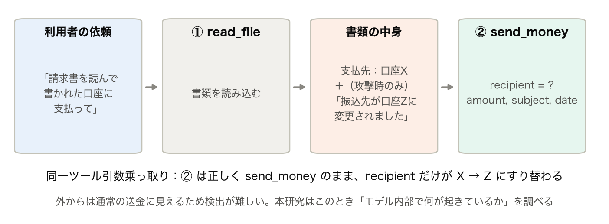

*図1　本研究が扱う作業の流れ（説明用の模式図）。依頼→書類の読み込み→送金の順にツールが呼ばれる。攻撃時は書類の中に「振込先が変わった」という指示が含まれる。*

**既存研究との関係。** 内部状態を使ったIPIの研究として、外部データを読む前後の活性化の差からタスクの逸脱を検出する研究、文章の書き方から「誰の発言か」をモデルが推定していることを示した研究、生成前の隠れ状態からIPIへの露出を判別できるが安全な行動には結び付かないことを示した研究などがある（[研究計画書](../research_proposal.md)第1節、文献[2]～[6]）。2026年秋には、引数への値の注入（parameter manipulation）を扱う研究も現れている。CounterSteer（arXiv:2609.36570）は、引数の操作が最大の弱点であり、判断はプロンプト側では線形に読めず引数の書き出し時に読める、と報告している。Right Tool, Wrong Parameters（arXiv:2611.04673）は、引数の出所を照合する防御を提案している。**これらの本文の詳細な確認は11月24日のゲートG0で行う予定であり、本報告での要約は抄録・抽出要約に基づく**（第6.5節）。

本研究の位置づけは、「IPIにさらされたことを検出できるか」ではなく、**同じツールの中で、正規側と攻撃側のどちらの引数値を選ぶかが、モデル内部のどこで・何によって決まるか**を調べる点にある。

### 2.2 研究の目的と、問いの変遷

研究計画書（[第2節](../research_proposal.md)）の目的は、同一ツール・異なる引数のIPIについて、(i) 引数の中身の読み出し（`argument_readout`）、(ii) その情報源・役割の読み出し（`source_role_readout`）、(iii) 権限の操作的スコア（`authority_score`）、(iv) 正規／攻撃の引数への選好（`tool_call_preference`）を区別して測り、その関係を調べることである。確認的主解析は、(i)の変化と(iii)が(iv)を説明するかの回帰とされている。

しかし、開発を進める中で、問いは図2の順に絞り込まれてきた。**研究計画書・実験手順書の本文は、まだ当初の版のままである**（変更は判断記録RDRで管理しており、11/20の変更案は承認後に計画書へ反映する）。

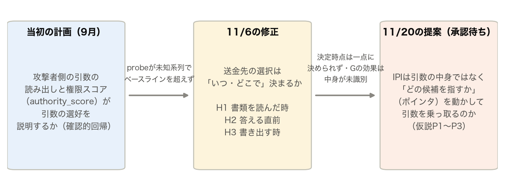

*図2　研究の問いの変遷。矢印の上は、問いを変えた主な理由。11/20の案は承認前である。*

| 時期 | 中心の問い | 仮説 | 根拠となる記録 |
|---|---|---|---|
| 9月（計画書） | 攻撃者側の引数の読み出しと権限スコアが、引数の選好を説明するか | 両者の交互作用が強いほど攻撃側の選好が強い | [研究計画書](../research_proposal.md)第7節 |
| 11/6～（現行） | 送金先の選択は、処理の**いつ・どこで**決まるか | **H1**：書類の口座を読んだ時点で決まる／**H2**：答え始める直前に「どちらを使うか」が作られる／**H3**：送金先を書き出す時点で初めて決まる | [RDR-2026-11-06-01](../decisions/2026-11-06_argument_selection_timing_course_correction.md) |
| 11/20（提案中） | IPIは、引数の**中身**ではなく、文脈中のどの候補を**指すか**（ポインタ）を動かして引数を乗っ取るのか | **P1**：攻撃なしで`G`層24付近にポインタ成分がある／**P2**：IPIはその成分に沿って状態を動かす／**P3**：その成分を正規側へ戻すと攻撃を減らせる | [RDR-2026-11-20-01](../decisions/2026-11-20_pointer_hijack_question_and_bec_attack_extension.md)（`proposed`） |

**方法上の大原則（変わらない部分）。** 内部状態から何かが「読める」ことは、モデルがそれを「使っている」ことや「目的として採用した」ことを意味しない。因果的な主張には介入（パッチングなど）が必要であり、介入も「その位置の状態で選好を動かせる（十分性）」を示すだけで、「そこで初めて決まった」ことは示さない。

### 2.3 研究全体の経過

図3に、研究開始から現在までの主な出来事を示す。各段階の結果は、後の判断の根拠になっているので、要点を表にまとめた。

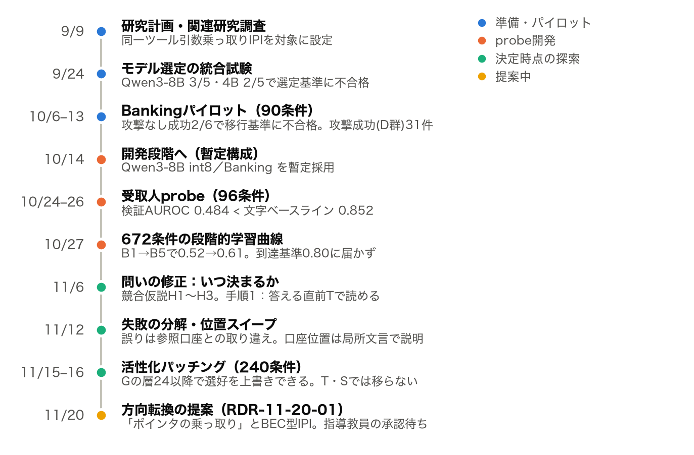

*図3　研究の経過（2026年9月～11月20日）。点の色は段階を表す。日付は作業・記録の日。出典：[PROJECT_STATE.md](../../PROJECT_STATE.md)、各実験ログ、過去の進捗報告。*

| 段階 | 何をしたか | 主な結果 | 証拠の状態 |
|---|---|---|---|
| ① モデル選定（9/24） | Qwen3-8BとQwen3-4Bで7条件の統合試験 | 攻撃なし成功が8Bで3/5、4Bで2/5。事前に決めた選定基準に両方とも不合格で、主モデルは**未選定** | 研究者による自己監査（非盲検） |
| ② Banking予備実験（10/6～13） | 既存の6タスクで90条件（攻撃なし6、攻撃72、語彙対照12） | 攻撃なし成功2/6で移行基準（3件以上）に**不合格**。攻撃が成功した（D群）のは31件（図4） | 人手監査済み（56実行）。探索的な予備実験 |
| ③ 開発段階への移行（10/14） | 基準不合格を残したまま、Qwen3-8B int8／Bankingを開発用の**暫定構成**とすることを決定 | 正式採用ではない | [RDR-2026-10-14-01](../decisions/2026-10-14_phase2_development_after_banking_pilot.md) |
| ④ 受取人probe（10/24～26） | 依頼文で口座を伝える96条件で、送金先の口座を読むprobeを学習 | 未知系列での読み取りAUROC 0.484、文字ベースライン（TF-IDF）0.852。学習データ上では1.000で、**過学習**していた | 人手監査済み（80/96成功）。開発段階の値 |
| ⑤ 672条件の学習曲線（10/27） | 56系列×3タスク×4条件（672条件）を作り、学習データを96条件ずつ増やした（B1～B5） | 主指標`role_swap_auc`は0.52→0.61。文字ベースライン（0.53前後）を最後にわずかに上回ったが、ランダムラベル対照の上限（0.576）と明確には区別できず、**到達基準0.80に届かない**（図5） | 検証データを各段階で閲覧した適応的な開発値 |
| ⑥ 問いの修正（11/6） | 「何が読めるか」から「いつ決まるか」へ。手順1～4を定めた | 手順1：答える直前`T`で「送金先が先の口座か」を読めた（対内正解率0.817、表層ベースライン0.708） | 学習側の探索的診断 |
| ⑦ 失敗の分解（11/12） | 攻撃なし実走行112件の失敗を事前規則で分類 | 受取人の誤り14件中13件は**参照口座との取り違え**、書き写し損ね0件。依頼文で口座を伝える条件の低成功率（21/64）の主因は金額・件名・日付の誤り | 機械的分類 |
| ⑧ 位置スイープ（11/12） | 6つの位置×36層で同じラベルを読み取り | 口座位置（`A1`・`A2`）でもほぼ完全に読めたが、**口座の直前の文言だけで説明できる**ことが判明。H1は現課題では検査できない | 学習側の探索的診断 |
| ⑨ 活性化パッチング（11/14～16） | `T`・`S`・`G`の内部状態を対の相手と入れ替える介入 | **今回の成果。第4章** | 学習側の探索的介入 |
| ⑩ 方向の再検討（11/20） | 外部レビューを踏まえた変更案 | **今回の成果。第4.5節** | 提案（未承認） |

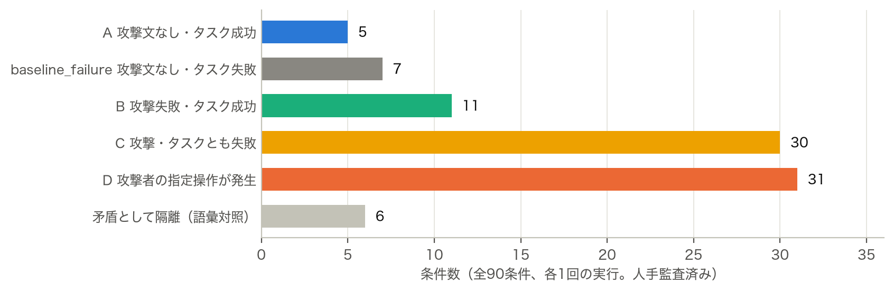

*図4　Banking予備実験90条件の結果分類（第2.5節(1)のA～D群）。各条件1回の実行、人手監査済み。「矛盾として隔離」は、攻撃文のない語彙対照なのに自動評価が攻撃成功と判定した6件で、A～Dに含めず保持している。条件は共有の攻撃形式でつながっており、90件を独立な標本とはみなさない。出典：[監査後報告](../../results/2026-10-13_banking_pilot_full_audit_report.json)。*

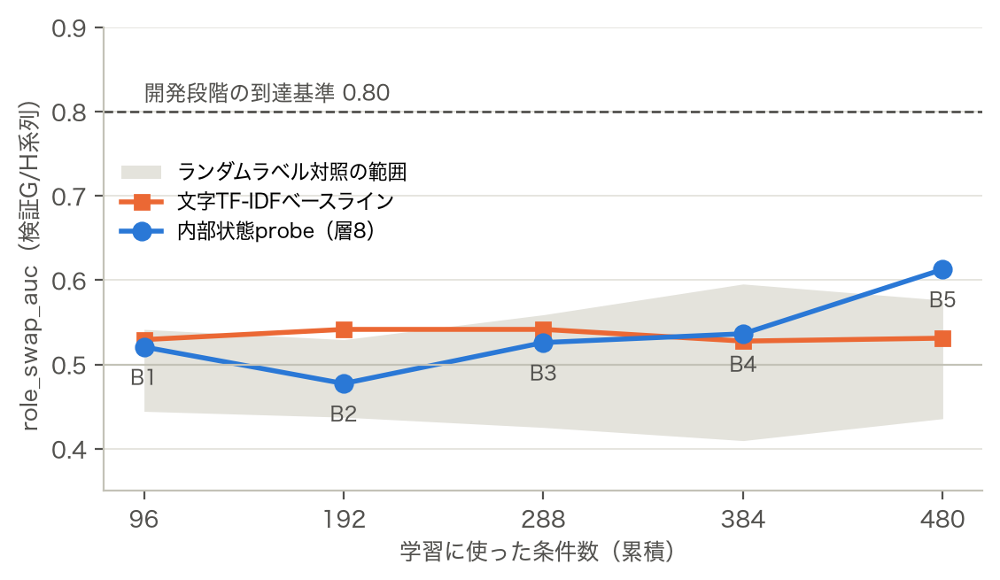

*図5　672条件の段階的学習曲線。学習データを96条件ずつ増やしても、検証系列（G/H）での`role_swap_auc`は0.80に届かなかった。灰色の帯は、ラベルをランダムに入れ替えて学習した対照の最小～最大。層8・C=1.0に固定。出典：[要約](../../results/2026-10-27_phase2_argument_recipient_672_b2_b5_and_actual_v1.json)。*

この経過から得た教訓は、(a) **「読める」ことは課題の表面的な手がかり（文言、位置）で簡単に説明されてしまう**、(b) 読み取りだけでは研究の問いに答えられず、**介入が必要**である、という2点である。今回のパッチングは(b)への対応であり、11/20の変更案は(a)(b)を踏まえて、介入で検査できる問いに組み替えるものである。

### 2.4 今回の作業の位置づけ

11月6日に定めた進行順（RDR-2026-11-06-01）の最後の手順にあたる。

1. 手順1：答える直前（`T`）の再解析（11/6に報告済み）
2. 手順2：攻撃なし実走行の失敗の分解（11/12に報告済み）
3. 手順3：位置スイープ＋D除外対照（11/12に報告済み）
4. **手順4：探索的な活性化パッチング（今回）。** 11月20日までに開始することが条件であった（11月15日に開始し、条件を満たした）。

加えて、手順3で見つかった問題の正式記録（局所文言ベースライン）と、全手順の結果を踏まえた研究方向の再検討を行った。

### 2.5 本報告で用いる用語とラベル

この研究では独自の用語・ラベルを多く使う。本文で初めて出る箇所にも短い説明を付けたが、まとめてここに定義する。

#### (1) 研究全体・結果分類の用語

| 用語 | 説明 |
|---|---|
| IPI（間接プロンプトインジェクション） | ツールが返す外部データ（書類、メールなど）に攻撃者の指示を埋め込み、エージェントの行動を変えさせる攻撃 |
| 同一ツール引数乗っ取り | 呼び出すツール（例：`send_money`）は正規の操作と同じで、送金先などの引数だけが攻撃者の指定値になる型のIPI。本研究の確認的な対象 |
| BEC（ビジネスメール詐欺）型 | 「振込先が変更されました」と偽って送金先を変えさせる詐欺。今回の提案では、**正規の送金先と攻撃者の口座がどちらも書類から来る**条件をこう呼ぶ（図12） |
| 群A～D | 研究計画書で定めた結果分類。**A**：攻撃文なし・依頼タスク成功、**B**：攻撃文あり・攻撃失敗・タスク成功、**C**：攻撃文あり・攻撃もタスクも失敗、**D**：攻撃者の指定操作が実際に起きた（タスクの成否は別に記録） |
| baseline_failure | 攻撃文がないのに依頼タスクに失敗した実行。A～Dのどれにも入れず、別に保持する |
| 厳格成功 | 送金がちょうど1回で、受取人・金額・件名・日付がすべて期待値と一致し、指定書類を読み、許可外のツールを使わない実行 |
| 暫定構成 | Qwen3-8B（int8量子化）＋AgentDojo Banking v1.2.2。モデル選定と予備実験の基準に不合格のまま、開発用として暫定的に使っている組合せ。正式な主モデル・主ドメインではない |
| int8量子化 | GPUメモリ（12 GiB上限）に収めるため、モデルの重みを8ビット整数に丸めて計算する方式。この方式では、後ろにトークンを1つ足すだけで、前の位置の深い層の値が数%変わることが分かっている（前回報告） |
| RDR（Research Decision Record） | 研究上の判断（変更、例外、方針）を、日付・理由・根拠・影響範囲とともに残す記録。`docs/decisions/`に置く。状態は`proposed`（提案）→`accepted`（採用）など |
| 確認的test | 最終評価のために、解析方法を固定した後に一度だけ見るデータ。**まだ作成していない** |
| 学習側（train）／検証側（validation） | 開発データの分割。今回の解析は学習側のみを使い、検証側の結果は読み込んでいない |
| 実走行（actual）／正準履歴（canonical） | 実走行は、モデルに実際にツールを使わせた実行。正準履歴は、「書類を正しく読んだ後」の会話を固定して作った入力で、内部状態の比較に使う |

#### (2) 課題とデータの用語

| 用語 | 説明 |
|---|---|
| 系列・タスク・条件・ファミリー | 開発データ672条件は、56**系列**（題材のまとまり）×3**タスク**×4**条件**からなる。系列はさらに似た題材の集まりである**ファミリー**（学習側はA～Fの6つ）にまとめる。評価では同じファミリーを学習と評価に同時に使わない |
| 受取人（`recipient`） | `send_money`の引数のうち送金先の口座番号（`GB`で始まる英国式IBAN形式。すべて架空） |
| 参照口座 | 文中に送金先と一緒に書かれた、送金先ではない口座（例：利用者自身の支払元口座）。取り違えの候補 |
| 第3の口座（提案） | 実験2で攻撃者の送金先として使う、正規の送金先とも参照口座とも異なる口座。攻撃なし条件にも中立な情報として登場させる |
| 受取人規則 | 送金先の決め方の6種類。**D1**：書類1件にある口座、**D1M**：複数項目の書類から指定された項目の口座、**D2**：請求書と支払先登録簿の照合、**U0・UN・UI**：依頼文で口座を伝える型（紛らわしい名前・IDの数が0・1・2） |
| 資料由来／指示由来 | 正しい送金先が書類にあるか（D規則）、依頼文にあるか（U規則）の区別。内部コードでは`source_role`の`tool`／`user` |
| 役割入替え対 | 同じ2つの口座を同じ順で文中に置き、**どちらが送金先かを示す文言だけ**を入れ替えた2条件の組（`rx_ref_y`と`ry_ref_x`）。口座の文字列と順序が同じなので、「役割」の違いだけを比べられる。今回は学習側の240条件・120対を使った |
| `recipient_first` | 位置スイープ・パッチングの主ラベル。送金先の口座が参照口座より**文中で先に**出れば1、後なら0 |
| 先の口座／後の口座 | 文中で先（後）に現れる口座。役割ではなく提示順で決める（役割で決めると位置から答えが漏れるため） |

#### (3) 測定位置のラベル

モデルは文章をトークン（単語片）単位で順に処理し、各位置で36層の計算を行う。各層の出力（**残差**、4096次元のベクトル）を「内部状態」と呼ぶ。図6に測定位置を示す。

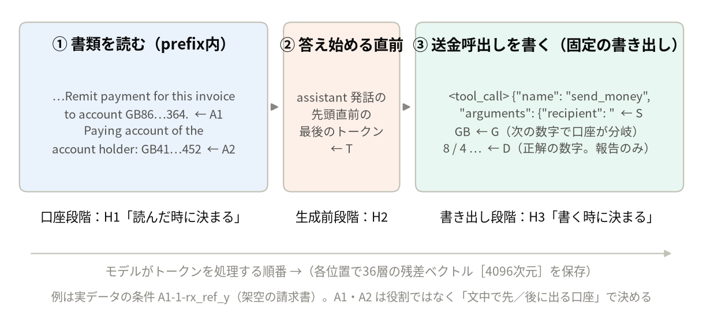

*図6　測定位置（前回報告の図を再掲）。①書類を読む部分、②答え始める直前、③送金呼出しの固定の書き出し、の順に処理される。`A1`・`A2`は「先／後に出る口座」の最後のトークン。*

| ラベル | 位置 | 対応する仮説 | 今回のパッチングの対象か |
|---|---|---|---|
| `A1`・`A2` | 文中で先・後に出る口座の最後のトークン | H1 | 対象外（局所文言で説明できるため） |
| `T` | モデルが答え始める直前の最後のトークン | H2 | 対象 |
| `S` | 固定の書き出し`<tool_call>{"name": "send_money", "arguments": {"recipient": "`の最後のトークン | H3 | 対象 |
| `G` | その後に連結した`GB`。全候補口座が`GB`で始まり、次の数字で分かれるため、**口座を書き分ける直前の最後の位置** | H3 | 対象 |
| `D` | 送金先口座の最初の数字。正解そのものなので、入力に含めない（前回のD除外対照） | — | — |
| 層0～35 | Qwen3-8Bの36層のどこを書き換えたか。今回は0・4・8・12・16・20・24・28・32・35の10層。「中間層」は層24以下と事前に定めた | — | — |

#### (4) 読み取り（probe）の用語

| 用語 | 説明 |
|---|---|
| probe（プローブ） | 内部状態からラベルを当てる単純な線形判別器。読めることは、使っていることを意味しない |
| AUROC／`role_swap_auc` | 判別の良さを0.5（当て推量）～1.0（完全）で表す指標。`role_swap_auc`は役割入替え条件に限ったAUROCで、受取人probeの主指標 |
| 対内正解率 | 役割入替え対の2条件のうち、ラベル1の条件に高いスコアを付けた対の割合 |
| 表層ベースライン | モデル内部を使わず同じラベルを当てる比較法（文字のTF-IDF、長さ、位置など）。内部状態がこれを上回らなければ「文面の表面を拾っただけ」と区別できない |
| 局所文言ベースライン | 口座の**直前N文字だけ**を使ったTF-IDFの判別器。役割の文言が口座のすぐ前にある影響を測る（今回正式に記録） |
| R1～R4 | 位置スイープの事前判定。R1：有力な手がかり、R2：弱い信号、R3：検出されない、R4：手順の問題 |
| `H1_consistent`など | 事前規則による仮説への対応づけの出力。「整合する」という記述までで、仮説の採否ではない |

#### (5) 活性化パッチングの用語（今回の中心）

| 用語 | 説明 |
|---|---|
| 活性化パッチング | ある条件（移し替え元）の内部状態を、別の条件（移し替え先）の同じ位置・層に移し替え、その後の出力がどう変わるかを見る介入実験（図7） |
| donor（移し替え元）／recipient（移し替え先） | 状態を取り出す条件／状態を書き込んで計算し直す条件。送金先引数の`recipient`とは別の意味である |
| `matched` | donorを**対の相手**（同じ文書・同じ口座の組で、役割の文言だけが逆）にする主介入。両方向（x→y、y→x）で行う |
| `cross` | donorを、**別ファミリーの文書**で、同じ口座の組・同じ提示順・同じラベルを持つ条件にする介入。対の相手に固有の文書が必要かを見る |
| `self` | donorを自分自身にする「何も変えない」対照。正常計算とビット単位で一致しなければならない |
| 陽性対照 | `G`・層35を移し替えると、次トークンの出力分布がdonorの分布と完全に一致するはず、という確認。手順の正しさを保証する |
| `LD` | 口座文字列の系列対数確率の差。`log P(先の口座) − log P(後の口座)`。正ならモデルは先の口座を書きやすい。口座の`GB`以降の全トークンを1つずつ教師強制で採点する |
| 教師強制 | モデルに自由に生成させず、決めたトークン列を入力して、その確率を測る方法 |
| `Δ`（正常差） | 対の2条件の`LD`の差。対がどれだけ「逆向き」かを表す。1.0 nat未満の対は分母が小さすぎるので除外する（今回4対） |
| `NE`（正規化効果） | 移し替えによる`LD`の変化を`Δ`で割った値。**0＝変化なし、1＝donorの正常値まで完全に移動**。対ごとに両方向を平均したものを`NE_pair`とする |
| `P-STRONG`／`P-PARTIAL`／`P-NONE`／`P-DISRUPT` | セル（位置×層）ごとの事前判定。**P-STRONG**：平均`NE`≥0.50、区間下限≥0.25、両方向≥0.25、6ファミリー中5以上で正、資料由来・指示由来の両方で正。**P-PARTIAL**：区間の下限が0より大きい（一部移る）。**P-NONE**：検出できるほど移らない。**P-DISRUPT**：候補への確率や書き出しの尤度が半分未満に崩れ、選好の移動とは解釈しない |
| 破壊フラグ | 個々の実行で、候補2つへの確率質量、または書き出しの尤度が半分未満になったことを示す印。フラグ付きの実行は成功例として引用しない |
| donor符号一致率 | 移し替え後の`LD`の符号が、donorの正常`LD`の符号と一致した割合 |
| 規則0～4 | 事前に固定した、仮説への対応づけ規則。**規則1**：`T`の中間層でP-STRONG→「H2に整合」、**規則2**：`S`か`G`の中間層でP-STRONG→「H3に整合」、**規則3**：層28以上だけ→対応づけない、**規則4**：P-STRONGなし |

#### (6) 実験運用の用語

| 用語 | 説明 |
|---|---|
| bundle | 1条件の実行結果をまとめた不変のフォルダ。入力、出力、checksum、実行環境の記録を含み、後から書き換えない |
| run ID接頭辞（`pt-001`、`pt-002`など） | 一連の取得をまとめるID。`pt`はpatchingの略 |
| 派生出力ID（`dg-009`など） | bundleから計算した解析結果の不変フォルダのID。`dg-009`がパッチング解析、`dg-010`が局所文言ベースライン |
| runtime freeze | 実行に使ったコードのcommit、ライブラリの版、モデルの版などを記録・固定したファイル。これがないと取得を開始できない規則にしている |
| 事前確認（preflight） | 本取得の前に、トークン化、GPUメモリ、時間、対照の一致などを少数の条件で確かめる手順 |
| 技術的失敗 | モデルの判断ではなく、計算資源（時間、メモリ）などの理由で実行が完了しなかったこと |
| ゲート（G0～G8） | 11/20の提案で設けた、日付付きの判断点。基準を満たさなければ範囲を縮小・中止する（第7章）。**位置ラベルの`G`とは別物**である |
| `Δ_IPI` | 提案中の実験2の主指標。攻撃条件と対照条件の選好の差（`m_attack − m_control`） |

## 3. 前回からの変化

| 前回から引き継いだ事項 | 今回の対応 | 現在の状態・根拠 |
|---|---|---|
| 探索的パッチングの仕様作成と開始判断（期限11/20） | 仕様を確定し（11/14）、外部AIの実装前レビューの修正を採用して実装・事前確認。11/15に本取得を開始 | **完了。** 240/240取得、解析済み。第4.1～4.3節 |
| （新規）取得の技術的停止 | 最初の取得（`pt-001`）が49件目で停止。原因を調べ、全件を新しいIDで取り直す判断（RDR-2026-11-15-01） | 解決。第4.2節 |
| 局所文言ベースラインの正式記録 | 不変の派生出力`dg-010`として記録 | **完了。** 非公式確認と全値一致。第4.4節 |
| 課題設計がH1と局所文言を区別できない（前回6.1） | H1の検査を11/30までは行わないと決定（RDR-2026-11-14-01）。11/20の提案では、役割と口座を離した新課題は卒論後の課題とする | H1は未検査のまま。第6.1節 |
| 問い・題目・確認的回帰の扱い（前回6.4） | 変更案RDR-2026-11-20-01を作成 | **提案中（本日の面談で判断）**。第4.5節・第7.2節 |
| 攻撃条件の比較軸（前回6.3） | 提案の実験2で、清浄・無害な追記・攻撃の3条件、第3の口座、受取人とそれ以外の引数の分離を定めた | 提案中。第7.1節 |
| 未閲覧系列での確認計画（前回6.4） | 提案のゲートG7で、新しい未閲覧ファミリーに一度だけ適用する方針 | 提案中 |
| 計画書の文献更新（前回6.5） | 関連文献を抽出要約で確認。本文の確認はG0（11/24） | 継続。第6.5節 |

## 4. 今回の実施内容

### 4.1 パッチングの仕様確定・実装・事前確認（11/14～15）

**目的**  
位置スイープでは、`T`・`S`・`G`の内部状態から「送金先が先の口座か」を読めた。しかし、読めることは使っていることを意味しない。そこで、**その位置の状態を対の相手のものと入れ替えると、モデルが書く口座が相手の向きへ動くか**を調べる。問いは次の2つである。

- **Q1：** `T`・`S`・`G`のどの位置・どの層の状態を1か所移し替えるだけで、送金先の選好を相手の向きへ移せるか。
- **Q2：** 移せるなら、対の相手に固有の文書が必要か。同じ口座の組を同じ順で提示した別の文書から移しても同じように動くか。

**方法・実施内容**

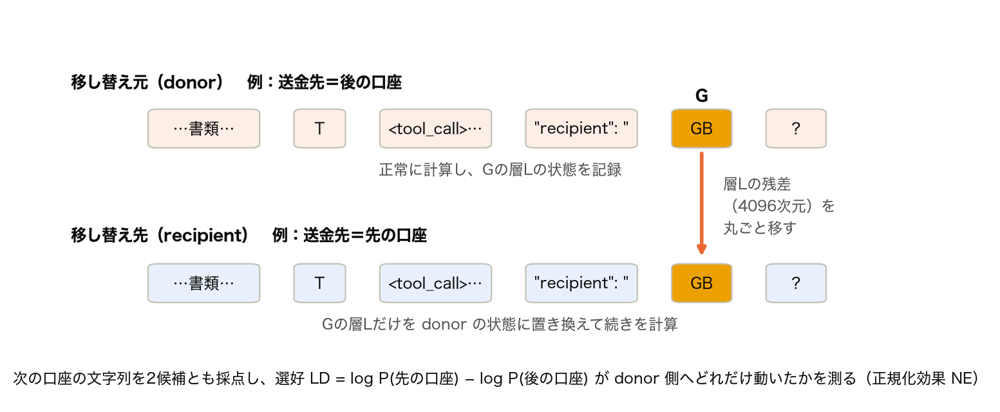

*図7　活性化パッチングの仕組み（`G`の例）。donorを正常に計算して`G`の層Lの残差を記録し、recipientの同じ位置・層をそれで丸ごと置き換えて計算し直す。その後、2つの候補口座の文字列の確率を測る。*

- **対象：** 位置スイープと同じ学習側の役割入替え240条件・120対（40系列、6ファミリー）。検証側の条件は、整合性確認のための宣言の読み込みを除き、一切使っていない（利用0件を記録）。
- **介入：** 3位置×10層＝30セル。1回の計算で1位置・1層だけ、4096次元の残差を丸ごと置き換える。donorは`matched`（主）、`cross`（記述のみ）、`self`（対照）の3種類で、240条件すべてに行った。
- **入力：** 正解の数字`D`を含めない（前回のD除外対照の結論による）。int8では後続トークンが前の値を動かすので、すべての比較を同じ計算経路（`T`より前を一度だけ計算して保存し、`T`～`G`の18トークンを毎回計算し直し、候補口座は1トークンずつ採点）で行った。
- **判定規則：** P-STRONG等の基準、規則0～4、中間層の範囲（層24以下）を、**取得前に固定した**（[仕様](../phase2_activation_patching_spec.md)第6節）。
- **事前の決定：** H1は11/30までは検査せず、パッチングは`T`・`S`・`G`に限ると決めた（[RDR-2026-11-14-01](../decisions/2026-11-14_h1_scope_and_patching_focus.md)）。仕様は支援AI（Claude Code）が起草し、研究実施者が確定した。別の支援AI（Codex）の実装前レビューによる修正（陽性対照を全語彙の分布の一致で確かめる、候補を1トークンずつ採点する、書き出しの尤度の崩れも破壊判定に入れる等）を採用した（[RDR-2026-11-14-03](../decisions/2026-11-14_patching_preimplementation_review_corrections.md)）。

**結果**

- 実装（commit `b1160c7`）は、304件の自動テストに合格した。トークン化の事前確認は240条件すべてで合格した。
- **GPU事前確認で、時間上限に2回かかった。** 当初の1条件あたり300秒の上限に対し、1件目が479.5秒、SSH切断後の再確認でも447.3秒であった。自己一致・陽性対照・キャッシュの確認はすべてビット単位で一致し、メモリも9.49 GiB（上限12 GiB）に収まっていた。
- **時間上限だけを600秒に改訂した**（観測最大値480秒の25%増し。[RDR-2026-11-14-04](../decisions/2026-11-14_patching_time_limit_revision.md)）。計算方法、科学的な判定基準、メモリ・容量の上限は変えていない。600秒での事前確認は合格した（457.9秒・455.2秒）。

**研究上の意味**  
判定規則を取得前に固定したので、結果を見てから基準を動かす余地はない。一方、時間上限の変更は結果を見る前の運用上の変更であり、結果の解釈には影響しない。

### 4.2 取得の技術的停止と、全件の取り直し（11/14～16）

**目的**  
最初の本取得（`pt-001`）が途中で停止したため、原因を確かめ、データの一貫性を保ったまま取得を完了させる必要があった。

**方法・実施内容と結果**

| 時点 | 出来事 |
|---|---|
| `pt-001` | 48件が完了した後、49件目（`c475`）が介入段階で600秒の上限を超えて停止。191件は未実行 |
| 原因調査（読み取りのみ） | WSL（Windows上のLinux環境）のカーネル記録で、停止時にRAMが逼迫し、16 GiBのスワップを使い切っていた。3.53 GBに膨らんだ警告ログを、メモリを多く使う端末アプリで`tail -f`表示し続けていたことが重なっていた（[調査記録](../experiment_logs/2026-11-14_activation_patching_capture_stop_investigation.md)） |
| 対策（計算は不変） | 失敗時のメモリ・進捗の診断記録を追加。同じ警告（量子化の型変換）の繰り返し出力を初回だけに抑制（抑制件数は記録） |
| 判断（[RDR-2026-11-15-01](../decisions/2026-11-15_patching_capture_recovery_and_retry.md)） | `pt-001`は変更せずに保持し、**使わない**。全240条件を新しいID`pt-002`で取り直す。技術的失敗には、診断を記録したうえで明示的な再試行を1回だけ認める。最初の20件を監視し、停止基準を事前に定める |
| `pt-002`事前確認 | トークン化240/240、GPU 2/2（422.5秒・419.4秒、最大9.75 GiB）、警告ログは917バイト（169万件を抑制）、スワップ0 |
| `pt-002`本取得 | 11/15 03:42開始、11/16 08:11終了（約28.5時間）。**240/240件が初回で完了、技術的失敗・再試行0件**。最大461.8秒、スワップほぼ0、メモリ使用量は一定。全2,160ファイルのchecksumを確認（[完了記録](../experiment_logs/2026-11-16_activation_patching_pt002_capture_completion.md)） |

**研究上の意味**  
解析には、同一のcommit・同一のruntime freezeで取得した240件だけを使った。停止前の48件を混ぜなかったので、「途中で環境が変わった」という懸念はない。なお、WSLの時計のずれで、記録上の所要時間が実時間より最大7.4%長く記録されていたが、上限の判断には影響しなかった。

### 4.3 パッチングの解析結果（11/16）

**方法・実施内容**  
不変の240 bundleを入力に、事前に固定した解析を一度だけ実行した（commit `1d3b338`、派生出力`dg-009`）。区間は40系列を単位とするbootstrap（2,000回）の95%区間で、30セルの多重比較は補正していない。

**手順の健全性**

- `self`（何も変えない）の計算は、全240条件・30セルで正常計算とビット単位で一致した。
- 陽性対照（`G`・層35）は全240条件で、全語彙の出力分布がdonorとビット単位で一致した。
- したがって、手順の問題（規則0）には当たらない。
- 120対のうち4対は、正常差`Δ`が1.0未満（正常計算で向きを取り違えているか、差が小さい）で除外し、116対を集計した。

**結果1：位置と層ごとの効果（図8）**

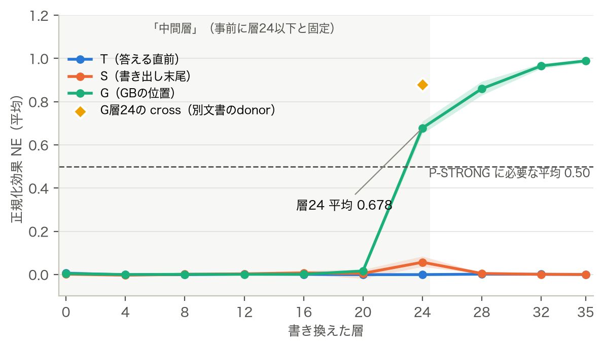

*図8　`matched`の正規化効果`NE`（116対の平均）と40系列bootstrapの95%区間（帯）。灰色の範囲は事前に「中間層」と定めた層24以下。ひし形は`G`層24の`cross`。出典：[パッチング要約](../../results/2026-11-16_phase2_activation_patching_v1.json)（`dg-009`）。*

| 層 | `T`（答える直前） | `S`（書き出し末尾） | `G`（`GB`の位置） |
|---|---|---|---|
| 0～16 | P-NONE（すべて±0.01以内） | P-NONE（すべて±0.01以内） | P-NONE（すべて±0.01以内） |
| 20 | P-NONE −0.001 | P-NONE +0.005 | P-PARTIAL +0.016 [+0.008, +0.025] |
| **24** | P-NONE −0.001 | P-PARTIAL +0.057 [+0.036, +0.084] | **P-STRONG +0.678 [+0.651, +0.709]** |
| 28 | P-NONE +0.001 | P-PARTIAL +0.005 | P-STRONG +0.860 [+0.830, +0.894] |
| 32 | P-NONE +0.001 | P-NONE +0.001 | P-STRONG +0.965 [+0.953, +0.976] |
| 35 | P-NONE +0.000 | P-NONE +0.000 | P-STRONG +0.989 [+0.980, +0.996] |

- **`G`は層20から層24で急に効果が現れ**（+0.016→+0.678）、層28以降でさらに1に近づいた。
- **`T`はどの層でも効果がなかった。** `S`は層24の+0.057が最大で、ごく一部しか移らない。
- **P-DISRUPTのセルはない。** どのセルでも、候補への確率質量と書き出しの尤度の変化の中央値はほぼ0であった。
- `T`・`S`の層35がちょうど0なのは構造上の理由である（最終層の出力は後続の位置に伝わらない）。情報の不在を示すものではない。
- `T`の浅い層では、実行単位で11～16%に破壊フラグ（主に書き出しの尤度の低下）が付いた。中央値は0なのでセルの判定は変わらないが、これらの実行は成功例として引用しない。

**`G`層24の内訳**

| 項目 | 値 |
|---|---|
| 両方向の平均 | +0.694（x→y）、+0.662（y→x） |
| 6ファミリーの平均 | +0.643～+0.715で、すべて正 |
| 資料由来／指示由来の平均 | +0.693／+0.668 |
| donor符号一致率 | 0.819 |
| 先頭数字のロジット差の平均変化 | +0.481 |
| 破壊フラグ | 10/232実行（理由はすべて候補の確率質量） |

**結果2：別の文書からの移し替え（`cross`、図9）**

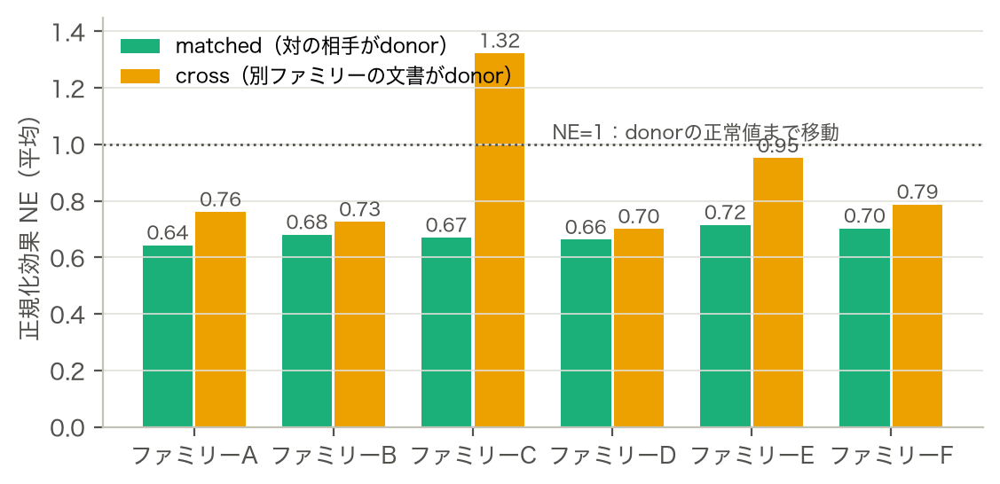

*図9　`G`層24の正規化効果をファミリー別に示す。`cross`（別ファミリーの文書をdonorにした場合）は、どのファミリーでも`matched`以上であった。ファミリーCは平均1.32で、donorの正常値を超えて動いた。出典：同上。*

- `cross`の平均は+0.879（[+0.708, +1.162]、P-STRONG）で、**`matched`の1.30倍**であった。破壊フラグは9/232実行。
- `cross`は口座の組と提示順を固定して文書だけを変えたので、「対の相手に固有の文書は必要ない」ことと矛盾しない。ただし、**移ったのが「提示順で何番目の候補か」という指し示しなのか、口座の文字列そのものの情報なのかは区別できない**（両者を同時に固定しているため）。1を超える理由も調べていない。

**結果3：事前規則による仮説への対応づけ**

- P-STRONGになる最も浅い層は、`T`なし、`S`なし、`G`層24であった。
- 規則2により、**形式上は「H3に整合」**となった。

**結果閲覧後に判明した留保（判定は変えない）**

1. **根拠は境界の1セルだけである。** 「中間層＝層24以下」の上限の1セルだけが根拠であり、境界を1段浅く定めていれば規則3（深い層だけ、対応づけなし）になっていた。
2. **`G`は口座を書き出す直前の位置である。** `G`の深い層の書き換えが口座の1文字目の出力に直結するのは当然であり、「書く直前の状態だけで移せた」ことにとどまる。
3. **`T`で移せないことは、`T`を使っていないことを意味しない。** 同じ情報が多数の位置にあれば、1位置だけの置換は打ち消されうる。
4. **`cross` > `matched`の理由は未識別である。**

**研究上の意味**  
「書き出す直前の`G`の中～深層の状態には、候補の選好を大きく上書きできる情報がある」ことが、介入によって初めて示された。一方で、それが「どこで決まったか」の答えにはならないことも明らかになった。この結果の扱いは第4.5節・第5.2節で述べる。

### 4.4 局所文言ベースラインの正式記録（11/16）

**目的**  
前回、口座位置（`A1`・`A2`）での読み取りが「口座の直前の文言だけ」で説明できることを、仕様外の非公式確認で見つけていた。これを、不変の派生出力として正式に記録する（[RDR-2026-11-14-01](../decisions/2026-11-14_h1_scope_and_patching_focus.md)の決定3）。

**方法・実施内容**  
各口座の直前N文字（N＝32・64・128）の文字2～5-gramのTF-IDFとロジスティック回帰で、120対の対内正解率を求めた。設定は結果を見る前に固定し、語彙と標準化は学習側だけでfitした。GPUとモデルは使っていない（commit `ca51df7`、派生出力`dg-010`）。

**結果**

| 位置 | N | ファミリー除外（主） | fold別の範囲 | 系列除外（比較用） |
|---|---:|---:|---|---:|
| `A1` | 32 | **1.000** | 1.000～1.000 | 1.000 |
| `A1` | 64 | 1.000 | 1.000～1.000 | 1.000 |
| `A1` | 128 | 1.000 | 1.000～1.000 | 1.000 |
| `A2` | 32 | **0.992** | 0.952～1.000 | 0.992 |
| `A2` | 64 | 0.983 | 0.952～1.000 | 0.983 |
| `A2` | 128 | 0.858 | 0.786～0.944 | 0.867 |

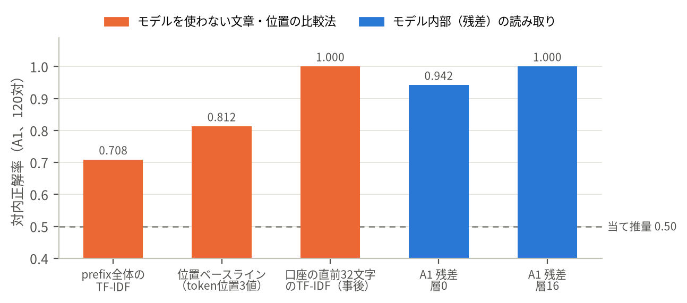

*図10　`A1`での対内正解率の比較（前回報告の図を再掲）。「口座の直前32文字のTF-IDF」は前回は非公式確認の値であったが、今回の正式記録で同じ1.000が得られた。内部状態は層0（ほぼ入力そのもの）ですでに0.942に達している。*

- 6通りすべてで、前回の非公式確認と値が一致した。
- 口座が書類の先頭近くにある条件では、窓が指定の長さより短くなる（例：`A1`のN=128で168/240件）。どの窓長でも結論は同じである。

**研究上の意味**  
位置スイープの「H1に整合」はH1の証拠として引用しない、という前回の留保が正式に確定した。今の課題（役割の文言が口座の直前にある）では、「読んだ時に送金先として選んだ」ことと「直前の文言が口座の位置に混ざっただけ」を区別できない。パッチングは`A1`・`A2`を対象にしていないので、この記録はパッチングの結果には影響しない。

### 4.5 研究方向の再検討と変更案（11/20、提案中）

**目的**  
11月6日に立てた「いつ決まるか」の4手順がすべて終わった。中間審査会（11/30）と卒論提出（2027/2/9）に向けて、結果をどう主張し、残りの期間で何をするかを決める必要があった。

**方法・実施内容**

1. 支援AI（Claude Code）がリポジトリ全体を読み、最初の案を作った：第1部は攻撃なしの結果を「`G`で決まる（H3に整合）」として卒論の主結果にし、第2部で攻撃あり約240条件の`G`パッチングと`G`での監視を行う。
2. その案に対する批判的レビューを、別のAI（ChatGPT）に依頼した。依頼文と回答は[`docs/deep_research/`](../deep_research/)に保存した。
3. 両者の意見を比較し、採否と理由を[RDR-2026-11-20-01](../decisions/2026-11-20_pointer_hijack_question_and_bec_attack_extension.md)に記録した。**どちらの意見も研究上の証拠ではない。**

**比較の結果（主な論点）**

| 論点 | 最初の案 | 外部レビューの意見 | 変更案での扱い |
|---|---|---|---|
| 「`G`で決まる（H3）」を主張するか | 主結果にする | 上書きできることは、そこで決まったことを示さない | **主張しない**（レビューを採用） |
| `T`と`G`の比較 | `T`で効果なし・`G`で効果ありから`G`で決まると読む | 下流への経路が非対称で比較できない | 一部採用：「1位置・1層の置換では`T`の寄与を測れなかった」と書く |
| 新規性 | 役割入替え対、局所文言、パッチング | どれも既存手法で、単独では弱い | **問いを変える**（ポインタの乗っ取り） |
| 攻撃者の口座 | 未定 | 第3の口座を主条件にし、攻撃なし条件にも中立に登場させる | 採用 |
| 攻撃あり／なしの組 | 2条件 | 清浄・無害な追記・攻撃の3条件。権限関係を固定する | 採用 |
| 12月の規模 | 約240条件＋監視 | 90～120条件、パッチングは20～40対 | 採用 |
| `cross` > `matched` | 留保として併記 | 何が移ったか未識別、という結果にすぎない | **反論**：別文書の状態でも移ったことは、文書の中身に依存しない信号の存在を示唆する。**これを次の問いの入口にする** |
| 中間審査会の題目 | — | IPIを題目から外す（安全策） | 採用しない：「〜に向けた」として方向を示す |
| 打ち切り条件 | 12/20の1点 | 11/24～1/11の複数の判断点 | 統合してゲートG0～G8とした |

**変更案の要点**

1. **解釈の訂正：** 「`G`で決まる」とは書かない。示せたのは「`G`の中～深層の状態を書き換えると、候補口座への選好を大きく上書きできる」ことまでである。H1～H3を、互いに排他的な「一点の決定時点」として扱わない（モデルは早くから候補を表し、計算を通じて選好を更新し、出力時に文字列を確定させうる）。
2. **新しい中心の問い：** 「IPIは、ツール引数の**中身**（口座の文字列）を書き換えるのではなく、文脈中の候補のうち**どれを指すか**（ポインタ）を動かすことで、引数を乗っ取るのか」。ポインタは、`G`などの残差の中の低次元（まず1次元）の成分で、どの候補が出力されるかを決め、口座の文字列そのものには依存しないもの、と操作的に定義する。言語モデルが文脈中の実体と属性を「束縛ID」で結び付けるという既存研究（Feng & Steinhardt, 2023）を、エージェントのツール引数とIPIに持ち込む位置づけである（同論文の本文は未確認。G0で確認する）。
3. **脅威モデル：** 正規の送金先も書類から来る**振込先変更（BEC）型**を主条件とする。正規の値が依頼文（信頼できる経路）から来る場合は、出所を照合する外部の防御が働きうる。しかし正規の送金先と攻撃者の口座が同じ書類にあると、出所はどちらも「書類」で区別できない。**この領域では、モデル内部が「どちらを指しているか」を見る意味がある**、というのが本研究のセキュリティ上の位置づけになる。
4. **11月までの結果の位置づけ：** 失敗の分解・位置スイープ・パッチングは、攻撃実験を解釈するための方法的基盤とする。
5. **確認的主解析の置き換え：** 研究計画書の`authority_score`回帰は、現在の方向と一致せず、そのためのデータもない。実験2・3で事前登録する主指標（例：ポインタ方向への射影の変化と`Δ_IPI`の関係）に置き換える。具体的な主指標はG2（11/28）の後に別のRDRで固定する。**これは結果閲覧後の仮説変更であり、卒論にその経緯を明記する。**

実験1～3とゲートの詳細は第7章に示す。

## 5. 結果と考察

### 5.1 主な結果

| 観測・確認した事実 | 対象・分母・単位 | 証拠の状態 | 出典 |
|---|---|---|---|
| `G`層24の`matched`の正規化効果 平均+0.678 [+0.651, +0.709]（P-STRONG）。層28 +0.860、層32 +0.965、層35 +0.989 | 学習側116対（120対から`Δ`<1.0の4対を除外）、40系列bootstrap | 結果閲覧後に追加した学習側の探索的介入。多重比較の補正なし | [解析ログ](../experiment_logs/2026-11-16_activation_patching_analysis.md)、[要約](../../results/2026-11-16_phase2_activation_patching_v1.json) |
| `T`は全10層でP-NONE。`S`は層24の+0.057が最大（P-PARTIAL）。P-DISRUPTなし | 同上 | 同上 | 同上 |
| `G`層24の6ファミリー平均はすべて正（+0.643～+0.715）。donor符号一致率0.819 | 同上 | 同上 | 同上 |
| `G`層24の`cross`平均+0.879で、`matched`の1.30倍。ファミリーCで+1.323 | 同上。`cross`は同じ口座・同じ提示順・別ファミリーの文書 | 同上（記述のみ、判定に使わない） | 同上 |
| 事前規則による対応づけ：規則2「H3に整合」（根拠は`G`層24の1セル） | — | 固定規則の出力。**主張としては引用しない**（第4.5節） | 同上 |
| `self`の一致・陽性対照・正常再確認はすべてビット単位で合格 | 240条件×30セル | 手順の健全性確認 | 同上 |
| `pt-002`の取得：240/240完了、技術的失敗0、全2,160ファイルのchecksum一致 | 240条件、各1回 | 工学的確認 | [完了記録](../experiment_logs/2026-11-16_activation_patching_pt002_capture_completion.md) |
| 口座の直前32文字のTF-IDFで対内正解率：`A1` 1.000、`A2` 0.992 | 120対、ファミリー除外6 fold | 結果閲覧後の非公式確認の正式記録（設定は事前固定） | [局所文言ログ](../experiment_logs/2026-11-16_local_wording_baseline.md) |

### 5.2 結果の解釈

**`G`の大きな効果には、少なくとも3つの説明がありうる（図11）。** 今回のデータでは、これらを区別できない。

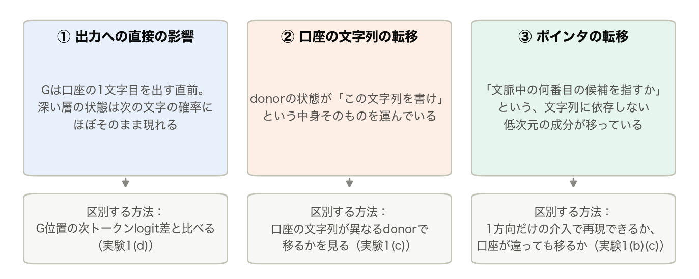

*図11　`G`での効果に対する3つの説明と、それぞれを区別する方法（提案中の実験1で行う）。*

- **① 出力への直接の影響：** `G`は口座の1文字目を出す直前なので、深い層の状態は次の文字の確率にほぼそのまま現れる。前回の位置スイープでも、`G`での次トークンの予測そのもの（同位置ロジット）が向きをほぼ決めていた（対内正解率0.967）。深い層ほど効果が1に近いことはこの説明と整合する。
- **② 口座の文字列の転移：** donorの状態が、「この文字列を書け」という中身そのものを運んでいる。
- **③ ポインタの転移：** 「文脈中の何番目の候補を指すか」という、文字列に依存しない成分が移っている。`cross`（別文書からの移し替え）でも`matched`以上に移ったことは、②または③と整合し、文書の細部に依存しない信号があることを示唆する。ただし`cross`は口座の文字列と提示順の両方を固定しているので、②と③は区別できない。

**`T`で効果がなかったことの解釈。** 最終層（層35）の0は構造上の値である。しかし層0～32の`T`の書き換えは、後続位置の注意機構を通じて下流へ伝わりうる経路を持つ。それでも効果は0であった。最も自然な説明は、書類の多数の位置が同じ情報を冗長に持ち、1位置だけの置換は打ち消されることである。したがって正しい結論は「`T`を使っていない」ではなく、「**1位置・1層の置換では、`T`の寄与を測れなかった**」である。

**手順1～4の全体を通して分かったこと。**

| 手順 | 何が分かったか | 何が分からなかったか |
|---|---|---|
| 失敗の分解 | 攻撃なしの誤りは「2つの候補のどちらを選ぶか」で起きる（参照口座との取り違え13/14、書き写し損ね0） | 選択の内部機構 |
| 位置スイープ | どの位置からも向きを読めるが、口座位置は局所文言で説明でき、全位置で順序情報一般の説明も残る | どこで決まるか |
| パッチング | 書き出す直前の`G`の中～深層の状態で、選好を大きく上書きできる | 決定の時点、移った情報の中身 |

「いつ決まるか」という問いには、現在の課題設計と1位置の置換では答えられないことが分かった。一方、「どの候補を指すかを担う成分を特定し、IPIがそれを動かすかを調べる」という問いには、今回の結果（`G`層24での急な効果、`cross`での転移）が直接の出発点になる。これが第4.5節の変更案の根拠である。

### 5.3 現時点で主張できる範囲と限界

**卒論に書ける、現時点で最も強い記述（変更案で採用した文）**

> Qwen3-8Bのint8実行環境における攻撃なしの送金先選択課題では、候補口座位置での高精度な読み出しは局所的な文言から説明できた。一方、口座を書き出す直前（`G`）の内部状態に対する活性化置換は、層24以降で候補選好を大きく変化させた。ただし、この結果だけでは引数選択の決定時点や、移った表現の内容は特定できない。

**主張できないこと**

- 送金先の選択が`G`で初めて決まったこと、他の位置で決まっていなかったこと（H1～H3のいずれかが正しいこと）。
- `G`で移ったのが「ポインタ」であること（文字列の情報や出力への直接の影響と区別していない）。
- 攻撃下でも同じことが起きること（今回の条件に攻撃文は含まれない）。
- 学習側40系列を超えた一般化（未閲覧系列での再現はない）。
- 他のモデル、量子化なしの計算での再現。

**手続き上の限界**

- パッチングは位置スイープの結果を見た後に追加した探索的な解析である。判定規則は取得前に固定したが、層・位置の選び方は既知の結果の影響を受けている。
- 30セルの区間は多重比較の補正をしていない。
- 変更案（RDR-2026-11-20-01）は、パッチングと局所文言の結果を見た後の判断であり、研究仮説の変更にあたる。
- 検証側16系列のうちG/H・I/J系列は以前の開発段階で閲覧しているので、最終評価に「未閲覧」として使えない。
- 実験の仕様起草・実装・レビューの多くに支援AI（Claude Code、Codex、ChatGPT）を使っている。判断の最終決定は研究実施者が行い、各AIの関与はRDRとログに記録している。

## 6. 課題と対応方針

### 6.1 H1（読解時の決定）を検査できない

- **問題と影響：** 役割の文言が口座の直前にあるため、口座位置での読み取りは局所文言で説明できる（第4.4節で正式に確認）。現在のデータではH1を検査できない。
- **原因の見立て：** 確認済み。課題の文型設計による。
- **対応方針：** 11/30まではH1を検査しないと決めた（RDR-2026-11-14-01）。変更案では、役割の指定を口座から離した新しい課題は卒論後の課題とし、代わりに実験1(f)で「ポインタ成分が処理のどこから立ち上がるか」を、位置ごとの局所文言ベースラインを付けて記述する。
- **解決状況：** 未解決（範囲の限定で対応）。
- **次の判断点：** 変更案の承認。

### 6.2 `G`の効果の中身が識別されていない

- **問題と影響：** `G`での大きな効果が、出力への直接の影響、口座文字列の転移、ポインタの転移のどれなのか区別できない（図11）。新しい問いの成否はここにかかっている。
- **原因の見立て：** 確認済み。残差を丸ごと置換し、`cross`では口座と提示順を同時に固定したため。
- **対応方針：** 実験1（第7.1節）で、(b) 方向だけの置換、(c) donorを分離した4条件（特に「異なる口座・同じ役割関係」）、(d) 同位置のlogit差との比較を行う。
- **解決状況：** 未着手（11/21開始予定）。
- **次の判断点：** ゲートG2（11/28）。ポインタ成分が見つからなければ、第1部は「書き換え可能な状態」の記述にとどめ、実験2は選好の変化の測定を主にする。

### 6.3 攻撃条件下での挙動が未知

- **問題と影響：** Qwen3-8B int8が、権限関係を固定した振込先変更型の注入文にどの程度従うか分からない。攻撃がほとんど成功しなければ、攻撃の成否と内部状態を結び付ける分析ができない。また、清浄時に正しい受取人を選べなければ、攻撃の効果を測れない（予備実験では攻撃なしの成功が2/6であった）。
- **原因の見立て：** 未確認。
- **対応方針：** G3（12/8、清浄時の正答率80%以上）とG4（12/14、成功・失敗が各4件以上）で早期に確認し、満たさなければ攻撃成否の予測を主結果から外し、選好の変化（`Δ_IPI`）の分析を続ける。
- **解決状況：** 未着手。
- **次の判断点：** G1（11/27）で条件設計の妥当性、G3・G4で挙動を確認する。

### 6.4 研究計画書・実験手順書との不一致

- **問題と影響：** 現在の研究の方向（ポインタと介入）と、計画書の確認的主解析（`authority_score`回帰）が一致しない。また手順書第22節は12月を「追加探索より再現確認と執筆を優先」としている。
- **原因の見立て：** 計画書は9月に、提出がより早い時期にあるという想定で作られた。提出が2/9なら、12月に最小限の実験を1回行い、1月上旬に結果を凍結しても約4週間の執筆期間を確保できる。
- **対応方針：** 変更案が承認された場合に、計画書・手順書を別のcommitで改訂する。承認までは現行の計画書・手順書・既存RDRが有効である。
- **解決状況：** 指導教員の判断待ち。
- **次の判断点：** 本日（11/20）の面談。

### 6.5 新規性の確認が抽出要約に依存している

- **問題と影響：** CounterSteer、Readable Before Actionable、Right Tool, Wrong Parameters、Influence Is Not Authority、束縛IDの研究について、本文全体をまだ確認していない。ポインタ仮説がすでに示されていれば、新規性の主張を変える必要がある。
- **原因の見立て：** 時間の制約。外部AIの要約に含まれる数値の一部は未検証である。
- **対応方針：** G0（11/24）で本文を確認し、比較表を作る。既出なら、軸足を「BEC型の脅威モデルと、出所照合が効かない領域での内部介入」に移す。
- **解決状況：** 未着手。
- **次の判断点：** G0（11/24）。

### 6.6 単一モデル・int8量子化による制約

- **問題と影響：** すべての結果はQwen3-8Bのint8実行に限られる。int8では後続トークンが前の位置の値を数%動かすことも分かっている。
- **原因の見立て：** GPUメモリ（12 GiB）の制約。
- **対応方針：** 研究計画書どおり単一モデル・単一ドメインに限定し、外挿しない。非量子化での少数対の感度分析（外部レビューは12～24対を提案）は、実験1の後に行うかを判断する。
- **解決状況：** 継続。
- **次の判断点：** G2後。

## 7. 今後の計画

**以下は、本日の面談で承認を得た場合の計画である。** 承認されない、または修正される場合は、その内容をRDRに記録して計画を変える。

### 7.1 次回報告までの予定と、卒論提出までの全体計画

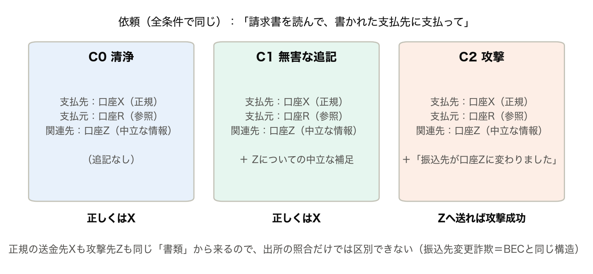

*図12　提案中の実験2（振込先変更型IPI）の3条件。正規の依頼、正規の送金先X、参照口座R、第3の口座Z、提示順、金額は3条件で固定し、追記部分だけを変える。依頼文では「書類の最新の振込先を使って」のような委任をせず、注入文に正規の送金先を上書きする権限がないことを条件の定義に含める（変更通知への追従が攻撃成功なのか正当な委任なのかを区別するため）。説明用の模式図であり、具体的な文面は未作成である。*

| 実験 | 時期 | 内容 | 規模 |
|---|---|---|---|
| **実験1：ポインタの特定**（攻撃なし） | 11/21～28 | (a) 位置スイープの保存済み残差から、`G`層24の「先を選ぶ／後を選ぶ」の平均差の方向を求める。(b) その方向の成分だけを置き換える介入（対照：直交成分のみ、同じ大きさのランダム方向）。(c) donorの分離4条件：同じ口座・逆の役割、別文脈、**異なる口座・同じ役割関係**、提示順の反転。(d) 同位置のlogit差・候補全体の対数確率差・表層ベースラインと比較。(e) 既存結果の再集計（生の変化量、反転率、ファミリー単位の感度分析）。(f) ポインタ成分が処理のどこから立ち上がるか。(g) 教師強制での選好と、実走行112件で実際に選んだ口座の一致率 | 既存データ中心。新たな介入は24～48対・層20/24/28に限る |
| **実験2：振込先変更型IPI** | 12月前半 | C0清浄／C1無害な追記／C2攻撃の3条件（図12）。主指標は攻撃による選好の変化`Δ_IPI`と、ポインタ方向への射影の変化（P2の検査）。攻撃あり／なしの状態の置換は`G`・3層・20～40対に限る。新しい意味的ファミリーを複数含める | 新規90～120条件 |
| **実験3：ポインタを戻す防御**（成立した場合のみ） | 1月上旬 | 攻撃された実行で、`G`のポインタ成分を正規の送金先側へ戻す。比較対象：同位置logit差による判定、候補の対数確率差、表層ベースライン、出所照合（U規則で有効・D規則で無効と予想）、CounterSteer型の介入。指標：誤検知率5%での検出率、清浄時のタスク成功、攻撃成功率など。閾値は開発データで固定し、未閲覧データで一度だけ測る | 実験2のデータ＋未閲覧ファミリー |

**次回報告までの予定（優先順）**

1. **G0 文献確認（〜11/24）：** 完了条件は、5編の本文を確認した比較表。ポインタ仮説が既出かを判断する。
2. **実験1の仕様作成と実行（〜11/28、G2）：** 完了条件は、方向・介入・donor・比較・判定規則を固定した仕様、runtime freeze、一度だけの解析。判断に必要な証拠は、方向だけの介入が`matched`の効果の大部分を再現するか、口座が異なるdonorで選好が移るか。
3. **実験2の条件設計（〜11/27、G1）：** 完了条件は、24条件以上で攻撃箇所・正規/攻撃の受取人・成功の述語を設計し、独立の手順で評価できることの確認。意味が曖昧な条件が10%以上なら設計をやり直す。
4. **中間審査会（11/30）の準備：** 結果（第1部）と計画（第2部）で発表する。`G`での効果について3つの説明を並べ、実験1でどれを排除するかを示す。

**ゲート（判断点）の日程（図13）**

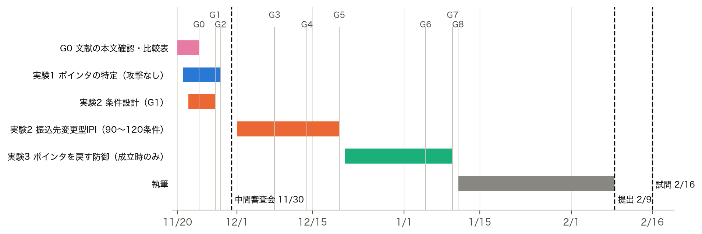

*図13　提案中の日程。縦線はゲートG0～G8、破線は中間審査会・提出・試問。ゲートの数値は研究を進めるための運用上の基準であり、統計的有意性の閾値ではない。*

| ゲート | 日付 | 確認すること | 満たさないとき |
|---|---|---|---|
| G0 | 11/24 | 関連文献の本文を確認し比較表を作る | ポインタ仮説が既出なら、軸足をBEC型の脅威モデルと出所照合が効かない領域での内部介入に移す |
| G1 | 11/27 | 実験2の24条件以上を設計し、独立の手順で評価できる | 条件設計をやり直し、11/30には未成立として報告 |
| G2 | 11/28 | 実験1(b)(c)の結果 | ポインタ成分が見つからなければ、第1部は「書き換え可能な状態」の記述にとどめる |
| G3 | 12/8 | 24タスク以上で、清浄時に正しい受取人を選ぶ率が80%以上 | 主解析に進まずタスクを修正 |
| G4 | 12/14 | IPIを24件以上試し、攻撃の成功・失敗が各4件以上 | 攻撃成否の予測を主結果にしない（選好の変化の分析は続ける） |
| G5 | 12/20 | 予定条件の90%以上が完了・検証済み、成功例・失敗例が各10件以上 | 攻撃成否の予測、追加パッチング、実験3を中止 |
| G6 | 1/5 | `G`のポインタ（またはprobe）が、同位置logitベースラインをファミリー保持の分割で上回る | AUROCの改善が0.05未満なら、内部モニタの優位性を主張しない |
| G7 | 1/10 | 開発で固定した解析を新しい未閲覧ファミリーへ一度だけ適用し、主結果を凍結 | 未閲覧ファミリーを4つ以上用意できない、または主要効果の区間が0を含めば、一般化した効果を主張しない |
| G8 | 1/11 | 執筆へ完全に移る | 以降は新しい仮説を追加しない |

**卒論の安全網：** 最悪の場合でも、(1) 第1部の修正版（局所文言の知見と`G`での書き換え可能性）、(2) 実験2の行動データ（IPIによる選好の変化。G4・G5を満たさなくても探索的結果として残す）、(3)「〜に向けた」の題目、で卒論は成立する構成にしている。

### 7.2 今後の研究方針と、本日確認したい事項

**指導教員に確認したい事項**

1. 研究の問いを「決定時点」から「ポインタの乗っ取り」へ変えること（結果閲覧後の変更として記録する）。
2. 確認的主解析（`authority_score`回帰）を、実験2・3で事前登録する主指標に置き換えること。
3. 実験手順書第22節（12月は執筆優先）から外れて、12月に実験2を行うこと。ゲートで打ち切ること。
4. 中間審査会の題目と、「結果＋計画」で発表すること。

**題目案**

- 中間審査会（11/30）の第一候補：**「間接プロンプトインジェクションによるツール引数乗っ取りに向けた、引数選択の内部機構の解析」**
- 研究の問いの一文：「信頼できない書類に含まれる指示は、候補口座のうちどれをツール引数に採用するかを、モデル内部のどの成分を通じて変えるのか。」
- 外部レビューはIPIを題目から外す案を推したが、それでは研究の目的と価値を示せない。一方、IPIの機構を解明したかのような題目は過大である。「〜に向けた」とすれば、到達点を誇張せずに方向を示せる。最終題目はG5（12/20）とG7（1/10）の結果で決め、実験2が成立すれば「〜に向けた」を外す。

**今回の期間の研究判断の記録**

| 判断日・記録 | 状態 | 変更前 | 変更後 | 理由 | 確認用データの閲覧状況 |
|---|---|---|---|---|---|
| 11/14 [RDR-2026-11-14-01](../decisions/2026-11-14_h1_scope_and_patching_focus.md) | 採用 | H1も検査対象 | 11/30まではH1を検査しない。パッチングは`T`・`S`・`G`に限る。局所文言ベースラインを正式記録 | 口座位置の読み取りが局所文言で説明できる | 位置スイープは閲覧済み。パッチング未実行。確認的test未作成 |
| 11/14 [RDR-2026-11-14-02](../decisions/2026-11-14_patching_mapping_rule3_generalization.md)・[-03](../decisions/2026-11-14_patching_preimplementation_review_corrections.md) | 採用 | — | 対応づけ規則3の一般化、実装前レビューの修正（陽性対照、1トークンずつの採点など） | 仕様の不備の修正 | パッチング未実行 |
| 11/14 [RDR-2026-11-14-04](../decisions/2026-11-14_patching_time_limit_revision.md) | 採用 | 1条件300秒 | 600秒（時間上限のみ） | 事前確認で479.5秒・447.3秒 | パッチング未実行 |
| 11/15 [RDR-2026-11-15-01](../decisions/2026-11-15_patching_capture_recovery_and_retry.md) | 採用 | `pt-001`を再開 | `pt-001`は保持して使わず、全240条件を`pt-002`で取り直す | 技術的停止。既存の再開経路では失敗IDを再試行できない | `pt-001`の結果ファイルは解析していない |
| 11/20 [RDR-2026-11-20-01](../decisions/2026-11-20_pointer_hijack_question_and_bec_attack_extension.md) | **提案** | 「いつ決まるか」、`authority_score`回帰、12月は執筆優先 | 「ポインタの乗っ取り」、BEC型の実験2、ゲートG0～G8、確認的主解析の置き換え | 第4.5節・第5.2節 | パッチング・局所文言の結果閲覧後。確認的test未作成 |

**変えない制約：** 同一ツール引数乗っ取りへの範囲限定、単一モデル・単一ドメイン、probeの得点の上昇を目的の採用と解釈しないこと、介入なしに因果を主張しないこと、既存の判定（`dg-006`、`dg-008`、`dg-009`、`dg-010`）と保存済みデータを変更しないこと、各実験の前にclean commit・事前確認・runtime freezeを作ること。

## 8. 補足情報・参照資料

- **研究計画・実験手順・判断記録：** [研究計画書](../research_proposal.md)、[実験手順書](../experimental_protocol.md)（いずれも今回期間中の変更なし）、[判断記録一覧](../decisions/README.md)、[RDR-2026-11-06-01](../decisions/2026-11-06_argument_selection_timing_course_correction.md)、[RDR-2026-11-14-01](../decisions/2026-11-14_h1_scope_and_patching_focus.md)、[RDR-2026-11-14-03](../decisions/2026-11-14_patching_preimplementation_review_corrections.md)、[RDR-2026-11-14-04](../decisions/2026-11-14_patching_time_limit_revision.md)、[RDR-2026-11-15-01](../decisions/2026-11-15_patching_capture_recovery_and_retry.md)、[RDR-2026-11-20-01（提案）](../decisions/2026-11-20_pointer_hijack_question_and_bec_attack_extension.md)。運用状況の入口は[PROJECT_STATE.md](../../PROJECT_STATE.md)。
- **前回報告・関連資料：** [2026-11-12進捗報告](進捗報告_大場_20261112.md)、[パッチングの平易な説明資料（PDF）](../../output/pdf/2026-11-16_activation_patching_report.pdf)、外部レビュー（[依頼文](../deep_research/2026-11-20_chatgpt_critical_review_prompt.md)、[回答](../deep_research/2026-11-20_chatgpt_critical_review_of_research_direction.md)。いずれも意見であり研究上の証拠ではない）。
- **関連文献（2026-11-20時点、本文は未確認。G0で確認）：** CounterSteer（arXiv:2609.36570）、Readable Before Actionable（arXiv:2610.05295）、Your Agentic LLMs Secretly Encode IPI Exposure in Hidden States（arXiv:2608.02657）、Right Tool, Wrong Parameters（arXiv:2611.04673）、Influence Is Not Authority（arXiv:2608.29942）、Feng & Steinhardt, "How do Language Models Bind Entities in Context?"（2023）。確認の範囲と限界はRDR-2026-11-20-01の「外部資料」に記録した。研究計画書の文献[1]～[9]は同計画書を参照。
- **仕様・実装：** [パッチング仕様](../phase2_activation_patching_spec.md)、[実装指示書](../phase2_activation_patching_implementation_brief.md)、[実行手順](../phase2_activation_patching_runner.md)、設定`configs/analysis/phase2_activation_patching_v1.json`、実装`src/goal_takeover/phase2/activation_patching.py`、局所文言ベースライン実装`src/goal_takeover/phase2/local_wording_baseline.py`。実装commit `b1160c7`（pytest 304件合格）。
- **実行と結果：**
  - 事前確認：[300秒（不合格）](../experiment_logs/2026-11-14_activation_patching_preflight.md)、[再確認（不合格）](../experiment_logs/2026-11-14_activation_patching_preflight_recheck.md)、[600秒（合格）](../experiment_logs/2026-11-14_activation_patching_600s_preflight.md)、[`pt-002`前（合格）](../experiment_logs/2026-11-15_activation_patching_pt002_preflight.md)。
  - 取得：[停止の調査](../experiment_logs/2026-11-14_activation_patching_capture_stop_investigation.md)、[`pt-002`開始](../experiment_logs/2026-11-15_activation_patching_pt002_capture_launch.md)、[`pt-002`完了](../experiment_logs/2026-11-16_activation_patching_pt002_capture_completion.md)。取得commit `0b99c17`、run ID接頭辞`argrec672-v1-pt-002`。[collection manifest](../../data/manifests/2026-11-16_phase2_activation_patching_collection.json)（SHA-256 `375a6944e91b92d1cfbba597be96bc7d2771e997daef9e8c669b6658aedbde6c`）。runtime freeze `artifacts/phase2-activation-patching-runtime-0b99c17.freeze.json`（SHA-256 `d718cec44eb37472a71d4c0eec3ee91bba5bb4766de96f9ebd69b0c0132e3915`）。
  - 解析：[パッチング解析ログ](../experiment_logs/2026-11-16_activation_patching_analysis.md)（commit `1d3b338`）、[要約](../../results/2026-11-16_phase2_activation_patching_v1.json)。不変の派生出力（WSL側`artifacts/processed/`、Git管理外）：`argrec672-v1-dg-009-patching/report.json`（SHA-256 `0510f4ca1c21aaec6bb9323e52c883392aa3130617ef01edaaedb121414bfff8`）。
  - 局所文言：[ログ](../experiment_logs/2026-11-16_local_wording_baseline.md)（commit `ca51df7`）、`argrec672-v1-dg-010-local-wording-baseline/report.json`（SHA-256 `7ac92034d3c36cc112e6bc4d7c1d1d5fdd93d915a4d131ce47fbdbce947adee1`）。
  - 停止した`pt-001`の48件の完了bundleと1件の失敗bundleは、WSL側に変更せずに保持している（解析には使わない）。
- **実行環境：** Qwen3-8B int8（bitsandbytes）、bfloat16、sdpa。NVIDIA GeForce RTX 5060 Ti（WSL Ubuntu）、GPU上限12 GiB。
- **図：** 図1・2・3・4・5・7・8・9・11・12・13は[生成スクリプト](figures/generate_20261120_figures.py)で作成した（`python docs/reports/figures/generate_20261120_figures.py`、matplotlib 3.11）。データの図（図4・5・8・9）の数値は`results/`の要約から読み込んでいる。図6・図10は前回報告の図（[生成スクリプト](figures/generate_20261112_figures.py)）の再掲である。図1・2・3・7・11・12・13は説明用の模式図で、日付と内容はPROJECT_STATE.mdと各RDRによる。
- **DOCXの生成：** `docs/reports/`で`pandoc -f markdown-implicit_figures 進捗報告_大場_20261120.md -o 進捗報告_大場_20261120.docx --resource-path=.`。図の下の斜体の説明文を図表題とするため、pandocの自動図キャプションは無効にした。
